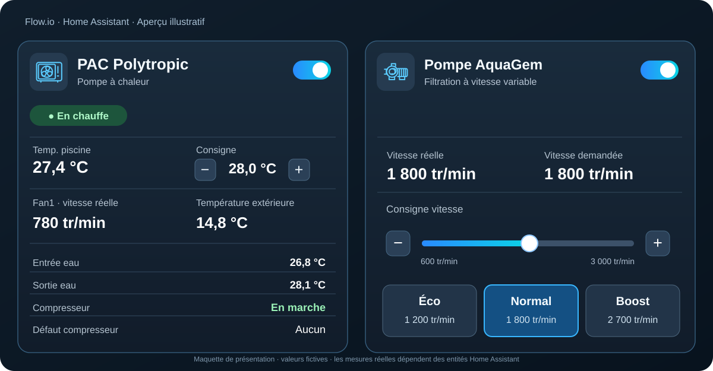

# PAC Polytropic et pompe AquaGem : cartes Home Assistant

Deux cartes Lovelace indépendantes, suivant le style des cartes Flow.io existantes (en-tête, couleurs du thème, composants natifs Home Assistant, présentation compacte). Elles lisent exclusivement l'état des entités Home Assistant déjà exposées par Flow.io. Elles ne font **aucune interrogation Modbus, aucun polling et aucun envoi MQTT direct**.

## Aperçu (illustration)

*Maquette illustrative en thème sombre, valeurs de démonstration. Le rendu effectif dépend du thème Home Assistant et des entités disponibles. La version de développement n'est pas encore intégrée à la distribution stable.*

## PAC Polytropic

~~~yaml
type: custom:flowio-polytropic-card
title: PAC Polytropic
entity_prefix: fio
device_slot: 7
power_entity: switch.fio_io_wat_htr
setpoint_entity: number.fio_pd7_setpoint
~~~

La carte affiche la température du bassin, la consigne, la température extérieure (télémétrie **ambient**), les températures entrée/sortie d'eau, **Fan1 en tr/min** (valeur brute, jamais en %), la fréquence du compresseur et le défaut compresseur. Le statut « En chauffe » requiert une fréquence compresseur positive et l'interrupteur chauffage ON. À défaut de télémétrie, la carte affiche « Marche demandée » et ne prétend jamais confirmer un démarrage physique.

## Pompe de filtration AquaGem

~~~yaml
type: custom:flowio-aquagem-card
title: Pompe de filtration AquaGem
entity_prefix: fio
device_slot: 0
power_entity: switch.fio_io_flt_pmp
setpoint_entity: number.fio_pd0_setpoint
eco_rpm: 1200
normal_rpm: 1800
boost_rpm: 2700
~~~

Affiche séparément la vitesse **réelle** (métrique `observed` du slot) et la vitesse **demandée** (entité HA `number`). Le curseur et les boutons +/− servent à modifier la consigne, jamais à inférer la vitesse réelle. Le curseur n'envoie sa commande **qu'au relâchement**. Les trois profils Éco/Normal/Boost sont configurables dans l'éditeur. Leurs valeurs initiales sont des exemples, pas des limites matérielles.

## Identités vérifiées dans le catalogue de Flow.io

Pour un préfixe `fio`, les métriques de base ont l'adresse `176 + slot * 32 + offset`.

| Mesure | Slot 7 Polytropic | Slot 0 AquaGem |
|---|---|---|
| Fan1 (offset 29, tr/min) | `sensor.fio_data_429` | — |
| Température ambiante (22) | `sensor.fio_data_422` | — |
| Entrée eau (19) | `sensor.fio_data_419` | — |
| Sortie eau (20) | `sensor.fio_data_420` | — |
| Défaut compresseur (26) | `sensor.fio_data_426` | — |
| Vitesse observée (1) | — | `sensor.fio_data_177` |
| Fréquence compresseur (métrique étendue) | `sensor.fio_data_746` | — |

La température bassin vient de `sensor.fio_io_wat_tmp`. Les entités `number.fio_pd7_setpoint` et `number.fio_pd0_setpoint` sont créées par le driver RS485 lorsqu'un profil de consigne numérique est disponible. La présence effective de ces entités doit être vérifiée dans Home Assistant.

## Commandes et sécurités

- Marche/arrêt : `switch.turn_on` / `switch.turn_off` après confirmation.
- Consignes : `number.set_value` après confirmation, avec bornes min/max imposées par l'entité HA.
- Les commandes sont désactivées en l'absence d'entité, de lecture de consigne ou de limites numériques.
- Une mesure `unknown`, `unavailable` ou non numérique apparaît comme **Indisponible**, jamais comme zéro.
- L'appel de service réussi n'atteste pas l'application physique. Les sécurités, interlocks, modes, le séquenceur RS485 et les délais AquaGem restent gérés par Flow.io.

## Développement et intégration

Les deux cartes sont enregistrées par `src/index.ts`. Le bundle HACS est construit ensuite via `npm ci`, `npm test`, `npm run build` et les tests Chromium de la CI. Aucun changement du firmware ESP32-S3 n'est nécessaire. Après validation de la branche et essai réel Home Assistant, fusionner via PR ; la publication de la distribution HACS reste une étape distincte.
